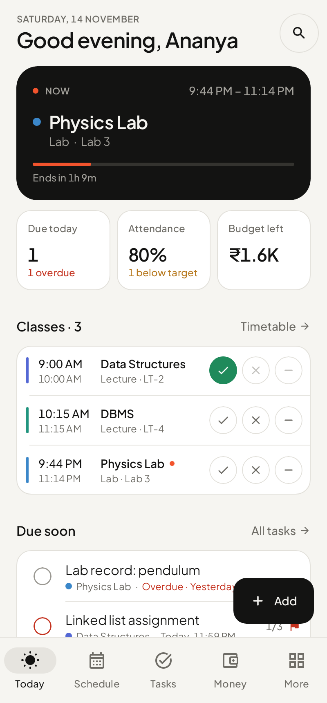
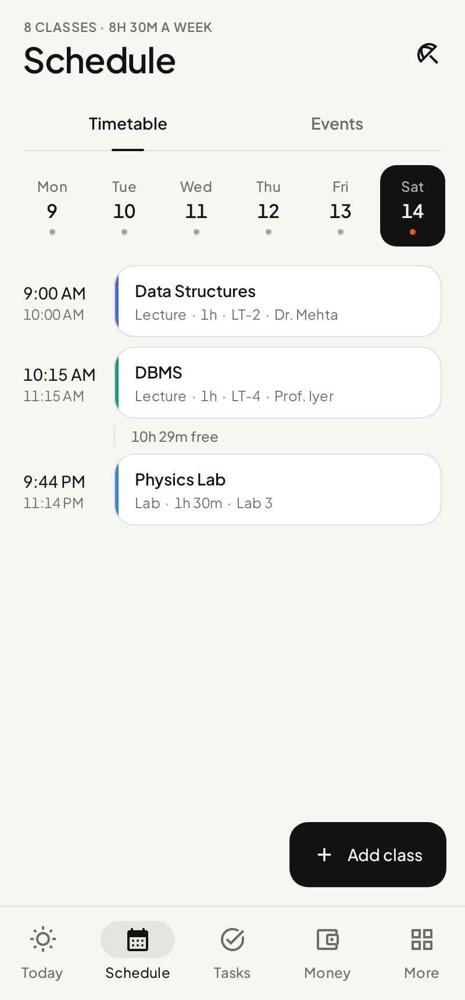
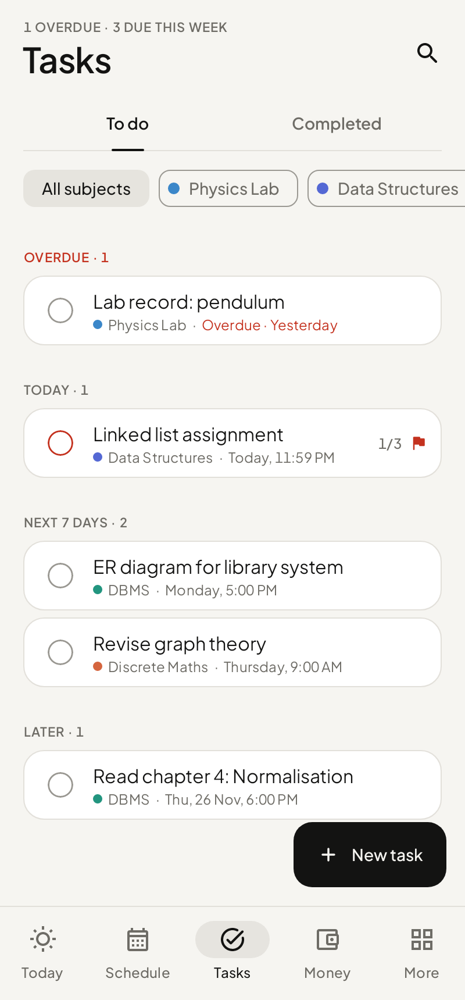
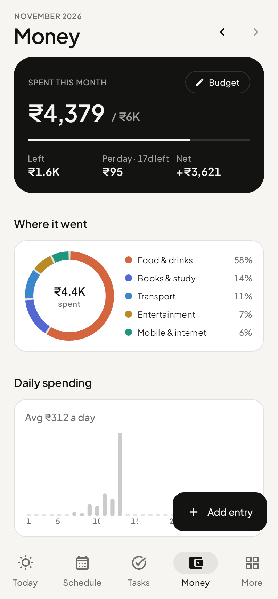
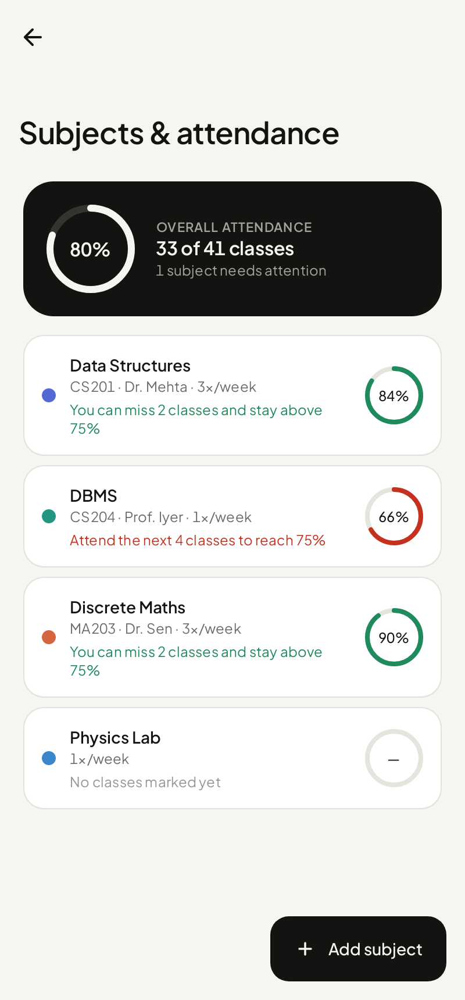
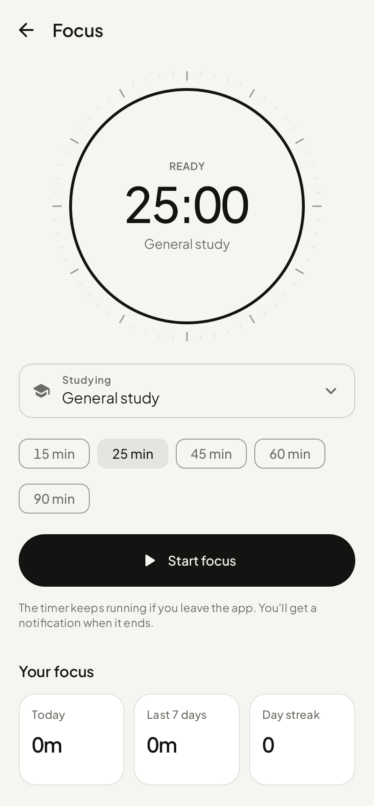
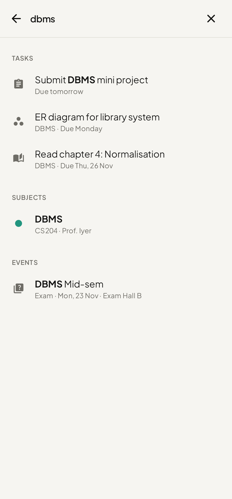
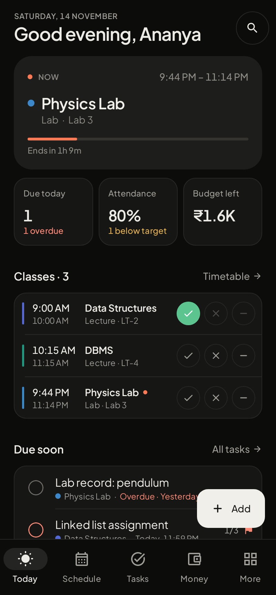

<p align="center">
  
</p>

<h1 align="center">EduBuddy</h1>

<p align="center">
  Your semester, in order. A private, offline student planner for Android.<br/>
  Timetable · Attendance · Deadlines · Events · Money · Focus
</p>

<p align="center">
  
  
  
  
</p>
<p align="center">
  
  
  
  
</p>

EduBuddy is built natively in Kotlin and Jetpack Compose. It needs no account and doesn't even request the internet permission, so everything stays on the phone.

## Download

Get the latest APK from the [Releases](../../releases) page (Android 8.0 or newer). See [CHANGELOG.md](CHANGELOG.md) for what's new.

## Features

| | |
|---|---|
| **Today** | What's on now and next, with a live countdown. One-tap attendance after each class, tasks due soon, upcoming events and your budget at a glance. |
| **Timetable** | Weekly classes (lecture, lab, tutorial) with room, teacher and reminder. Add a class to several days at once, get clash warnings, and see free gaps between classes. |
| **Holidays & breaks** | Mark festival breaks, exam weeks or a single day off. Class reminders pause and attendance isn't asked for, while your timetable stays intact. |
| **Events** | Seminars, guest lectures, workshops and exams, with speaker, venue and reminder. |
| **Tasks** | Assignments, projects, exam prep and reading, with due time, priority, checklist and notes. Grouped Overdue / Today / Tomorrow / Next 7 days / Later. Swipe to complete or delete, with Undo. Mark done or snooze from the notification. |
| **Attendance** | Per-subject percentage against your college's minimum (75% by default, per-subject overrides). Shows exactly how many classes you can miss, or how many you must attend to recover. |
| **Money** | Expenses and income in ₹, a monthly budget with a daily allowance, a category breakdown, daily spending and CSV export. |
| **Focus** | A timer tracked per subject that keeps running when the app is closed. Shows daily and weekly totals and a streak. |
| **Search** | One search box for tasks, subjects, teachers, events, holidays and expenses. |
| **Reminders** | Classes, deadlines, events, focus end and an optional morning summary. Uses exact alarms when allowed and falls back gracefully when not. |
| **Widget** | Next classes and tasks due by tomorrow on your home screen. |
| **Privacy & data** | App lock (fingerprint, face or screen lock), JSON backup and restore, and erase all data. Light, dark and system themes, plus optional Material You colours. |

## Design

EduBuddy uses an "Ink & Ember" identity: warm paper, near-black ink and a single ember accent reserved for *now*. The colours, type, motion rules and assets are documented in [docs/BRAND.md](docs/BRAND.md).

## Building

Requirements: JDK 17 and the Android SDK (platform 35).

```bash
./gradlew assembleRelease      # → app/build/outputs/apk/release/app-release.apk
./gradlew testDebugUnitTest    # unit tests + full UI journey on Robolectric
```

`AppFlowTest` drives the real app on Robolectric. It goes through onboarding, seeds realistic data, visits every screen, creates a task through the editor (checking the database row and the armed alarm), searches, opens holidays and switches to dark mode. Screenshots go to `app/build/screenshots/`. CI runs the same steps on every push ([.github/workflows/android.yml](.github/workflows/android.yml)).

### Signing

Release builds fall back to the debug key so they install for testing. To sign with your own key, copy `keystore.properties.example` to `keystore.properties` (git-ignored), point it at your keystore and build again. Android only accepts updates signed with the same key, so keep that keystore safe and backed up.

## How it works

```
app/src/main/java/com/edubuddy/app/
  core/          Money, attendance maths, time helpers (pure Kotlin, unit-tested)
  data/db/       Room entities, DAOs, database and migrations
  data/repo/     Repositories: the only writers; keep reminders and widget in sync
  data/prefs/    DataStore settings and persisted focus-timer state
  data/backup/   JSON backup/restore, CSV export
  domain/        Agenda building, morning summary, focus controller
  reminders/     AlarmManager scheduling, notifications, receivers
  widget/        Glance home-screen widget
  ui/theme/      Colour, type and shape tokens
  ui/common/     Design-system components, forms, charts
  ui/feature/    One package per screen
```

Dependencies are wired by hand in `AppContainer` (`EduBuddyApp.kt`).

Design decisions worth knowing:

- **One owner for reminders.** `ReminderScheduler` is the only class that touches AlarmManager. Every write re-syncs that item's alarm under a stable request code, so edits replace alarms, deletes cancel them, and duplicates can't happen. All alarms are rebuilt on app start, reboot, update and clock or timezone changes.
- **Holidays are checked when a reminder fires**, so adding or removing a break never has to reshuffle alarms.
- **Time.** Deadlines and events are stored as instants. Weekly classes are stored as local day + minutes, so the timetable survives timezone and DST changes.
- **Money** is stored as integer paise, with Indian digit grouping (₹1,25,000) implemented explicitly.
- **Writes survive navigation.** They run on an app-level scope, so saving and leaving a screen immediately never loses data.
- **Backups** are versioned JSON, restored inside a single transaction: if anything is inconsistent, nothing changes. Older backups load in newer versions, and newer backups are rejected with a clear message.
- **Schema changes ship explicit migrations.** The Room schema is exported to `app/schemas`, and there's no destructive fallback.

## Licence

Plus Jakarta Sans is used under the SIL Open Font License 1.1.
